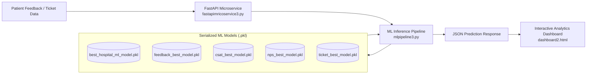

<div align="center">

# 🏥 Healthcare Patient Feedback & Sentiment Analytics Engine

**End-to-End Multi-Model Machine Learning Microservice for Patient Sentiment, CSAT, NPS & Ticket Intelligence**

[](https://www.python.org/)
[](https://fastapi.tiangolo.com/)
[](https://scikit-learn.org/)
[](https://jupyter.org/)

[](LICENSE)

*Transform unstructured hospital patient feedback into real-time sentiment scores, CSAT/NPS predictions, and automated support ticket intelligence.*

</div>

---

## ⚡ Overview

Healthcare providers process thousands of patient touchpoints daily across departments, discharge surveys, and support channels. Manually triaging this volume leads to missed escalations and delayed service recovery.

This repository delivers a **production-ready ML pipeline and FastAPI microservice** backed by five specialized serialized models (`.pkl`) and an interactive web dashboard (`dashboard2.html`). It automates:
* **Patient Sentiment & Feedback Classification** — Real-time polarity and complaint detection.
* **CSAT & NPS Forecasting** — Predictive scoring for Customer Satisfaction and Net Promoter Score trends.
* **Automated Ticket Intelligence** — Classification and prioritization of hospital support tickets.
* **Unified Hospital ML Inference** — Consolidated scoring through a central inference pipeline (`mlpipeline3.py`).

---

## 🏗️ System Architecture



---

## 🧠 Model Suite

Each predictive task is trained, evaluated, and exported independently via dedicated Jupyter notebooks for modular retraining and zero-downtime model swaps.

| Model Artifact | Training Notebook | Core Responsibility |
| :--- | :--- | :--- |
| `best_hospital_ml_model.pkl` | — | Core hospital-wide predictive analytics & unified scoring |
| `feedback_best_model.pkl` | `feedback_model.ipynb.ipynb` | Patient feedback sentiment & polarity classification |
| `csat_best_model.pkl` | `csat_train.ipynb` | Customer Satisfaction (CSAT) score prediction |
| `nps_best_model.pkl` | `nps_model.ipynb` | Net Promoter Score (NPS) promoter/detractor forecasting |
| `ticket_best_model.pkl` | `ticket_model.ipynb` | Support ticket categorization & escalation priority |

---

## 🛠️ Tech Stack & Tools

| Category | Tools & Technologies |
| :--- | :--- |
| **Core Language** | Python 3.10+ |
| **API & Serving** | FastAPI, Uvicorn, Pydantic |
| **Machine Learning & NLP** | scikit-learn, pandas, NumPy, NLTK, Joblib / Pickle |
| **Experimentation** | Jupyter Notebook, Matplotlib, Seaborn |
| **Frontend & Visualization** | HTML5, CSS3, JavaScript (`dashboard2.html`) |
| **Development & Version Control** | Git, GitHub, VS Code |

---

## 📂 Repository Structure

```text
sentiment-analysis/
├── LICENSE                         # Project license
├── README.md                       # Project documentation
├── fastapimricoservice3.py         # FastAPI application & REST endpoints
├── mlpipeline3.py                  # Core preprocessing & multi-model inference pipeline
├── dashboard2.html                 # Interactive frontend analytics dashboard
│
├── best_hospital_ml_model.pkl      # Master hospital ML model
├── csat_best_model.pkl             # Trained CSAT prediction model
├── feedback_best_model.pkl         # Trained feedback sentiment model
├── nps_best_model.pkl              # Trained NPS prediction model
├── ticket_best_model.pkl           # Trained ticket classification model
│
├── csat_train.ipynb                # CSAT training & evaluation notebook
├── feedback_model.ipynb.ipynb      # Feedback sentiment training notebook
├── nps_model.ipynb                 # NPS training & evaluation notebook
└── ticket_model.ipynb              # Ticket model training & evaluation notebook
```

---

## 🚀 Quick Start

### 1. Clone the Repository
```bash
git clone [https://github.com/SAIKARTHIK296/sentiment-analysis.git](https://github.com/SAIKARTHIK296/sentiment-analysis.git)
cd sentiment-analysis
```

### 2. Set Up a Virtual Environment
```bash
python -m venv venv

# Windows (PowerShell)
.\venv\Scripts\Activate.ps1

# macOS / Linux
source venv/bin/activate
```

### 3. Install Dependencies
```bash
pip install fastapi uvicorn scikit-learn pandas numpy nltk joblib pydantic
```

### 4. Launch the FastAPI Microservice
```bash
uvicorn fastapimricoservice3:app --host 0.0.0.0 --port 8000 --reload
```
Once running, access the interactive API documentation at:
* **Swagger UI:** `http://127.0.0.1:8000/docs`
* **ReDoc:** `http://127.0.0.1:8000/redoc`

### 5. Open the Analytics Dashboard
Open `dashboard2.html` directly in your browser (or serve it via VS Code Live Server) while the FastAPI server is running on port `8000`.

---

## 🔄 Retraining Models

To retrain any model with updated hospital datasets:
1. Open the corresponding notebook (`csat_train.ipynb`, `nps_model.ipynb`, `ticket_model.ipynb`, or `feedback_model.ipynb.ipynb`) in Jupyter Notebook or VS Code.
2. Point the data loader to your updated CSV/dataset.
3. Run all cells to re-evaluate metrics and overwrite the corresponding `*_best_model.pkl` artifact.
4. Restart the FastAPI server to load the updated model weights.

---

## 📄 License

This project is licensed under the terms of the [LICENSE](LICENSE) file.

---

<div align="center">
  Built by <strong><a href="https://github.com/SAIKARTHIK296">K A Venkata Sai Karthik</a></strong>
</div>
